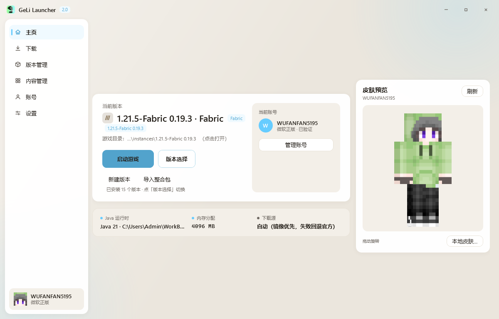
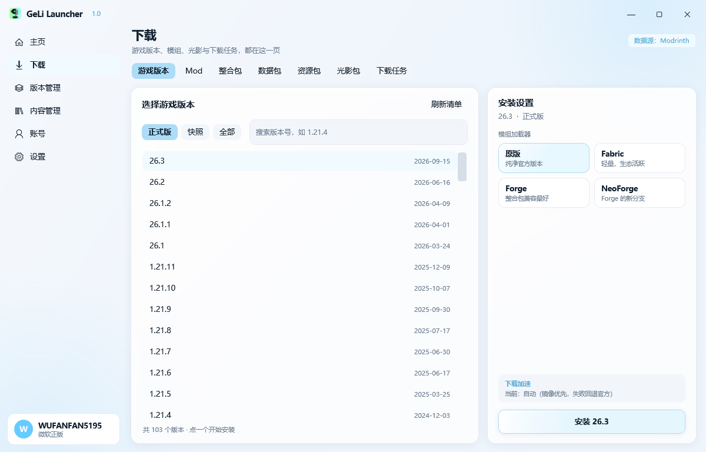
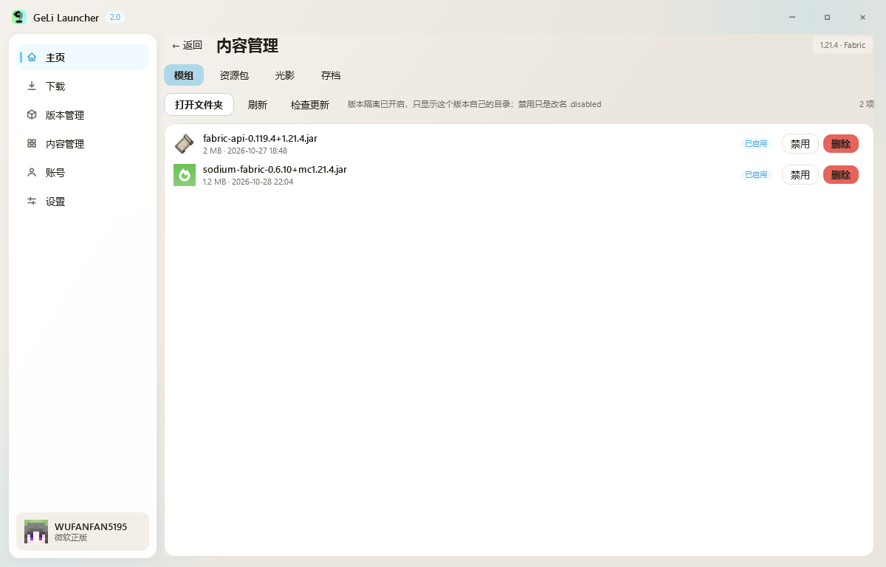
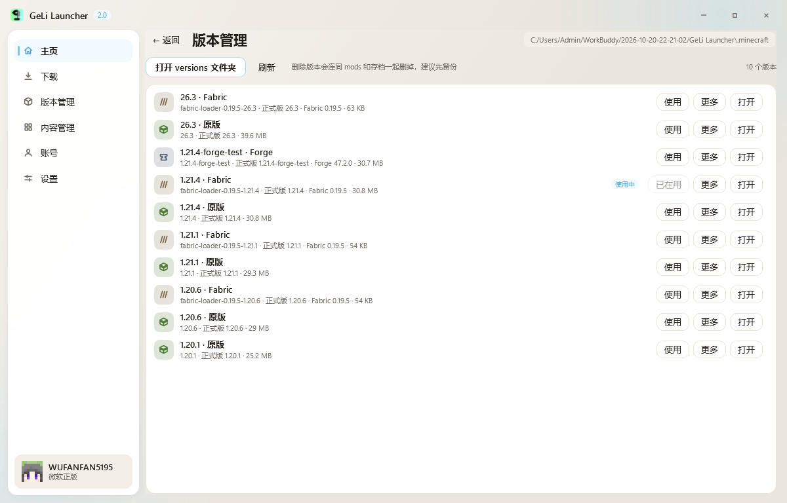
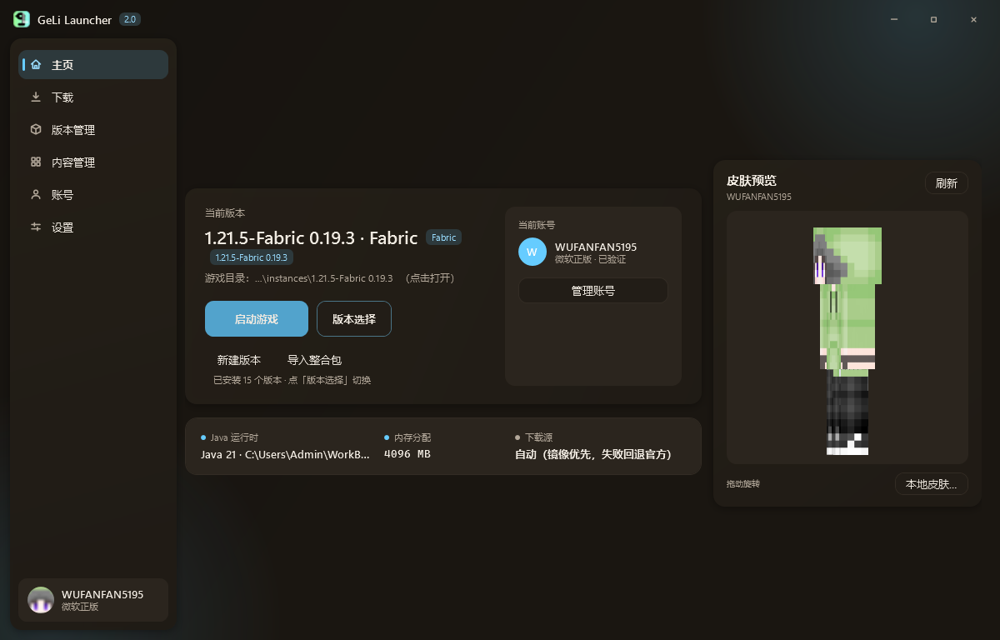
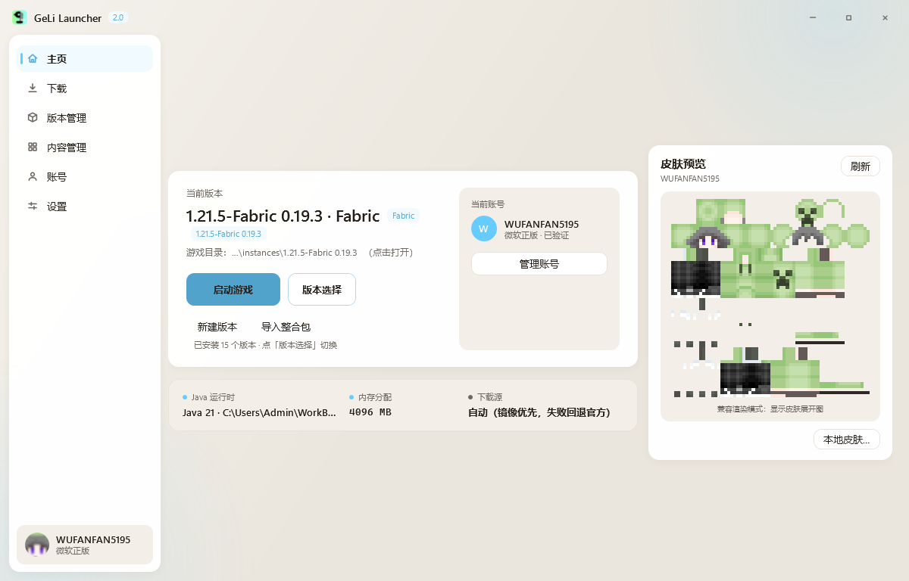

# GeLi Launcher

一个用 **WPF / .NET 8** 写的 Minecraft 启动器

> A lightweight Minecraft launcher built with WPF (.NET 8). Windows only.


---

## 截图

| 主页 | 下载 |
|---|---|
|  |  |

| 内容管理（读取模组自带图标） | 版本管理 |
|---|---|
|  |  |

| 暗色模式 | 兼容渲染 |
|---|---|
|  |  |

---

## 功能

### 版本与加载器

- 从 Mojang 官方清单安装任意正式版；支持 **Fabric / Quilt / Forge / NeoForge**
- 版本管理：重命名（只改显示名，不动磁盘）、复制、删除、指定独立 Java 与内存
- 版本图标：自定义图片 / 整合包图标 / 原版草方块 / Fabric 织线 / Forge 铁砧
- 版本隔离：每个版本独立的 `mods`、`saves`，也能自由切换多个 `.minecraft` 目录

### 资源下载

- 一个页面收拢全部入口：**游戏版本 / Mod / 整合包 / 数据包 / 资源包 / 光影包 / 下载任务**
- Modrinth 搜索，自动按当前实例的游戏版本与加载器筛选
- 下载任务统一排队、可取消，侧栏显示进行中数量

### 整合包

- 导入 `.mrpack`：解析 `modrinth.index.json`，自动装对应游戏版本 + 加载器 + 全部模组
- 实例自动标记为整合包，版本列表显示整合包图标；包里带 `icon.png` 就直接当版本图标

### 账号与皮肤

- 微软正版登录（WebView2 内嵌 OAuth），离线档案
- 头像取皮肤头部 8×8，方形 + 最近邻放大，保持像素颗粒
- 每个账号可单独换本地皮肤（64×64 / 64×32），老版 64×32 自动补全成 64×64
- 主页 3D 皮肤预览：拖动旋转，松手后左右轻摆

### 内容管理

- 模组 / 资源包 / 光影 / 存档统一管理：启用、禁用（改 `.disabled`）、删除、备份
- 图标读的是**内容自己的图**：jar 内 `fabric.mod.json` 的 icon、zip 内 `pack.png`、存档的 `icon.png`
- 存档体积后台统计，不卡界面

### 可靠性与体验

- **单实例**：重复双击把已有窗口叫到前台，不再叠一堆
- **启动前自检**：补齐缺失的库 / 资源 / natives，Fabric API 装错版本会自动替换
- 崩溃后读 `crash-report` 给出人话解释
- 自动备份存档（保留份数可调）
- 滚轮速度、玻璃透明度可调，深浅两套主题

---

## 下载

Windows x64，自包含运行时（无需安装 .NET）：

- [GeLiLauncher-2.0-win-x64.exe](https://github.com/LumiCyan/GeLi-Launcher/raw/dist/GeLiLauncher-2.0-win-x64.exe) · 64 MB
- 国内加速：[通过镜像下载](https://gh-proxy.com/https://raw.githubusercontent.com/LumiCyan/GeLi-Launcher/dist/GeLiLauncher-2.0-win-x64.exe)

版本说明见 [Releases](https://github.com/LumiCyan/GeLi-Launcher/releases)。

## 从源码构建

需要 **.NET 8 SDK**（Windows）。

```bash
git clone https://github.com/LumiCyan/GeLi-Launcher.git
cd GeLi-Launcher

# 调试运行
dotnet run

# 发布为单文件（自包含，约 64 MB）
dotnet publish GeLiLauncher.csproj -c Release -r win-x64 \
  -p:SelfContained=true \
  -p:PublishSingleFile=true \
  -p:EnableCompressionInSingleFile=true \
  -p:IncludeNativeLibrariesForSelfExtract=true \
  -p:DebugType=none -o dist
```

也可以用仓库里的 `publish.ps1`（同时产出全量与精简两种包）。

> 体积说明：自包含单文件约 64 MB，其中绝大部分是 .NET 运行时与 WPF 本身。
> WPF **不支持 IL 裁剪**（`PublishTrimmed` 会被 SDK 直接拒绝），因此没有进一步压缩空间。
> 如果把 `SelfContained` 设为 `false`，exe 只有 ~1.7 MB，但需要机器上装有 .NET 8 Desktop Runtime。

---

## 目录结构

```
.
├─ App.xaml(.cs)          应用入口：单实例、渲染模式、全局异常
├─ MainWindow.xaml(.cs)   主窗口：侧栏导航、二级面板、启动遮罩
├─ Themes/
│  └─ Styles.xaml         全部控件模板（按钮 / 输入框 / 卡片 / 滚动条 / 复选框…）
├─ Core/                  无 UI 的业务层
│  ├─ Gll.cs              配置、路径、实例、版本扫描
│  ├─ Installer.cs        原版 / Fabric 安装（下载 → 校验 → 解压 natives）
│  ├─ Forge.cs            Forge / NeoForge 安装器流程
│  ├─ Modpack.cs          .mrpack 导入
│  ├─ Mods.cs             Modrinth 查询、下载、Fabric API 兜底与版本校验
│  ├─ Launcher.cs         拼启动参数、拉起游戏进程
│  ├─ Net.cs              带镜像回退与分段下载的网络层
│  ├─ Skin.cs             皮肤加载、老版补全、头像裁切
│  ├─ ContentIcons.cs     模组 / 资源包 / 存档图标提取
│  └─ Theme.cs            调色板派生（含暗色、玻璃透明度）
└─ Views/                 各页面与对话框
```

---

## 调试用环境变量

开发时用来复现特定界面，不影响正常使用。

| 变量 | 作用 |
|---|---|
| `GLL_PAGE=home\|download\|versions\|content\|accounts\|settings` | 启动后直接跳到某页 |
| `GLL_DL_TAB=mod\|modpack\|resourcepack\|shader\|tasks` | 下载页的默认分类 |
| `GLL_SHOT=<路径>` | 渲染完成后截图并退出 |
| `GLL_WAIT=<毫秒>` | 截图前等待时间 |
| `GLL_SET_SCROLL=<像素>` | 设置页滚动到指定位置（配合截图） |
| `GLL_SOFTWARE_RENDER=1` | 强制软件渲染 |
| `GLL_SKIN_FILE=<png>` | 用指定图片当皮肤（验证 UV / 头像） |
| `GLL_NOICON=1` | 跳过远程图标下载，验证兜底图标 |
| `GLL_DIAG=0` | 关闭诊断日志 |

日志默认写在 `%TEMP%\gll-diag.log`（超过 256 KB 自动清空）。

---

## 已知限制

- 仅支持 Windows x64（依赖 WPF 与 WebView2）
- 第三方资源来源目前只接了 Modrinth（CurseForge 需要 API Key，接口留好了但没默认启用）
- 软件渲染下 WPF 的 `Viewport3D` 不出图，皮肤预览会自动降级成 2D 展开图
- 界面文字以中文为主

---

## 许可证

[MIT](LICENSE)

## 免责声明

本项目与 Mojang Studios / Microsoft 无关联。使用它下载、启动的游戏本体版权归各自所有者，请通过正版账号登录。
